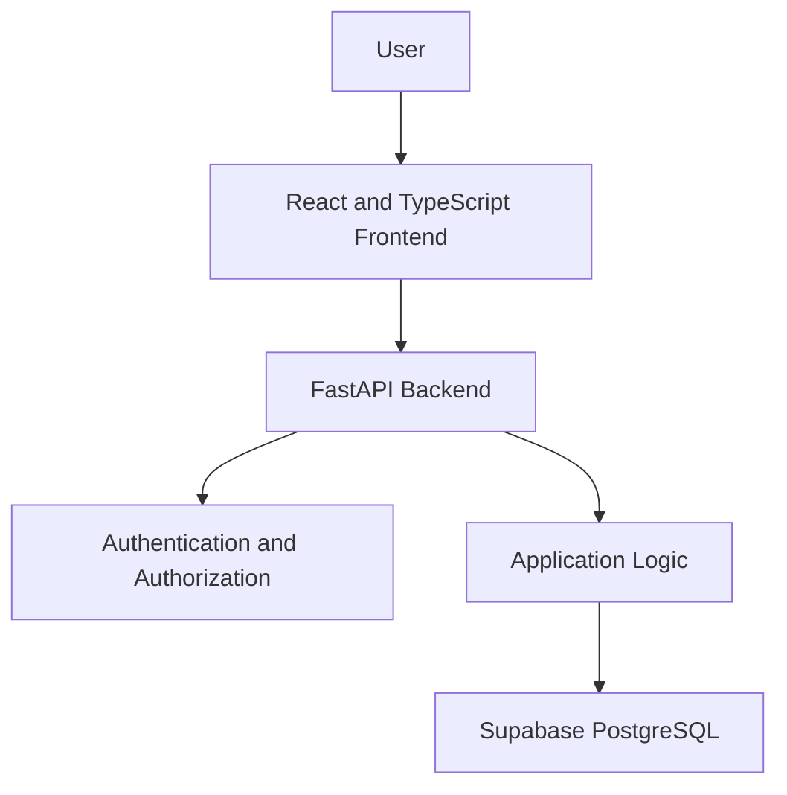

# Saints Nexus — E-Learning Web Application

**Saints Nexus** is a full-stack e-learning web application developed as an individual project for CSE309: Web Applications at Independent University, Bangladesh (IUB).

The platform combines course management, user authentication, profile and session management, administrative functionality, activity logging, and a permission-controlled collaborative workspace.

## Live Application

| Component | Link |
|---|---|
| Frontend | https://2110400-saintsnexus-frontend.vercel.app/ |
| Backend API | https://2110400-saintsnexus-backend.vercel.app |
| API Health | https://2110400-saintsnexus-backend.vercel.app/api/health |
| API Documentation (Swagger) | https://2110400-saintsnexus-backend.vercel.app/docs |
| GitHub Repository | https://github.com/Pistol-Saint/2110400-S6-SaintsNexus |

## Technology Stack

| Layer | Technology |
|---|---|
| Frontend | React 19, TypeScript |
| Frontend Build Tool | Vite |
| Backend | Python, FastAPI |
| Database | Supabase PostgreSQL |
| Authentication | JWT |
| Password Hashing | Argon2 |
| API Documentation | OpenAPI / Swagger UI |
| Deployment | Vercel |
| Version Control | Git, GitHub |
| Testing | Pytest |

## Features

### Authentication and User Management
- User registration and login.
- Password hashing using Argon2.
- JWT-based authentication.
- Access-token expiration.
- Refresh-token rotation.
- Logout and session revocation.
- Profile management.
- Password change functionality.
- Session management.

### Course Management
- Course catalogue.
- Course retrieval.
- Administrative course creation.
- Administrative course updates.
- Administrative course deletion.

### Administrative Dashboard
- User statistics.
- User listing.
- Client-side search and filters.
- Pagination.
- Role management.
- Ban and unban functionality.
- Administrative activity logs.

### PROJECT AVENGERS — Collaborative Workspace

Saints Nexus implements a permission-controlled collaborative workspace named **PROJECT AVENGERS**.

| Member | Create | Update | Assign | View |
|---|---|---|---|---|
| saints_adminX (Owner) | Yes | Yes | Yes | Yes |
| saints_userZ | Yes | Yes | No | Yes |
| saints_userZ2 | No | No | Yes | Yes |
| saints_userZ3 | No | No | No | Yes |

Permissions are enforced by the backend.

## Architecture

The application follows a client-server architecture.

- **Frontend:** React and TypeScript.
- **Backend:** FastAPI.
- **Database:** Supabase PostgreSQL.
- **Authentication:** JWT-based authentication.
- **Deployment:** Vercel.



## Project Structure

```text
SaintsNexus/
├── backend/
│   ├── main.py
│   ├── database.py
│   ├── routers/
│   │   ├── auth.py
│   │   ├── admin.py
│   │   └── groups.py
│   └── tests/
│       └── test_api.py
├── frontend/
│   └── src/
│       ├── context/
│       ├── pages/
│       ├── services/
│       ├── types/
│       └── App.tsx
├── docs/
│   ├── PRD.md
│   ├── SRS.md
│   ├── TDD.md
│   ├── FINAL_REPORT.md
│   └── FINAL_SUBMISSION_CHECKLIST.md
└── README.md
```

## Local Development

### Backend

1. Navigate to the project root directory.
2. Create and activate a Python virtual environment.
3. Install the required backend dependencies.
4. Configure the backend environment variables.
5. Start the FastAPI server.

Example:

```powershell
python -m venv .venv
.\.venv\Scripts\Activate.ps1
pip install -r backend\requirements.txt
$env:PYTHONPATH = (Resolve-Path backend).Path
python -m uvicorn main:app --reload --port 8002
```

The local API will be available at:

`http://127.0.0.1:8002`

Swagger documentation:

`http://127.0.0.1:8002/docs`

### Frontend

1. Navigate to the frontend directory.
2. Install the dependencies.
3. Configure the frontend environment variable.
4. Start the development server.

Example:

```powershell
cd frontend
npm install
npm run dev
```

Configure the frontend API base URL using:

`VITE_API_URL`

For local development, the variable can point to:

`http://127.0.0.1:8002`

The frontend development server will display its local URL after starting.

## Automated Testing

Backend automated tests are implemented using Pytest.

Run the tests from the project root:

```powershell
python -m pytest backend\tests -v
```

## Frontend Production Build

Run from the project root:

```powershell
npm run build --prefix frontend
```

## Documentation

The `docs/` directory contains project documentation, including:

- Product Requirements Document (PRD).
- Software Requirements Specification (SRS).
- Technical Design Document (TDD).
- Final Project Report.
- Final Submission Checklist.

## Security

Implemented security-related functionality includes:

- Argon2 password hashing.
- JWT authentication.
- Access-token validation and expiration.
- Refresh-token rotation.
- Hashed refresh-token storage.
- Session revocation.
- Administrative authorization.
- Group permission enforcement.
- Banned-user enforcement.
- Administrative audit logging.

Security enhancements such as dedicated rate limiting, brute-force protection, and HttpOnly-cookie-based authentication remain potential future improvements.

## Limitations and Future Improvements

- Dedicated brute-force protection and rate limiting.
- HttpOnly-cookie-based authentication.
- CSV export.
- Server-side filtering and pagination.
- Expanded security analytics.
- General group creation and member administration.
- Additional automated security and permission tests.
- Expanded e-learning and content-management features.

## AI Assistance Disclosure

OpenAI ChatGPT was used as an AI-assisted tool during project development for technical troubleshooting, programming guidance, explanation and review of implementation approaches, debugging support, project planning, and drafting and editing documentation. The student remains responsible for the submitted source code, implementation decisions, testing, verification, and final project work, and should be able to explain the submitted implementation.

## Course Information

- **Course:** CSE309 — Web Applications
- **Institution:** Independent University, Bangladesh (IUB)
- **Semester:** Autumn 2026
- **Section:** 6
- **Project:** Saints Nexus E-Learning Website