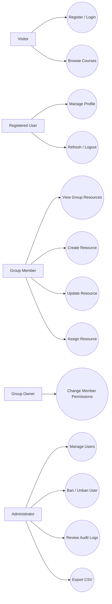
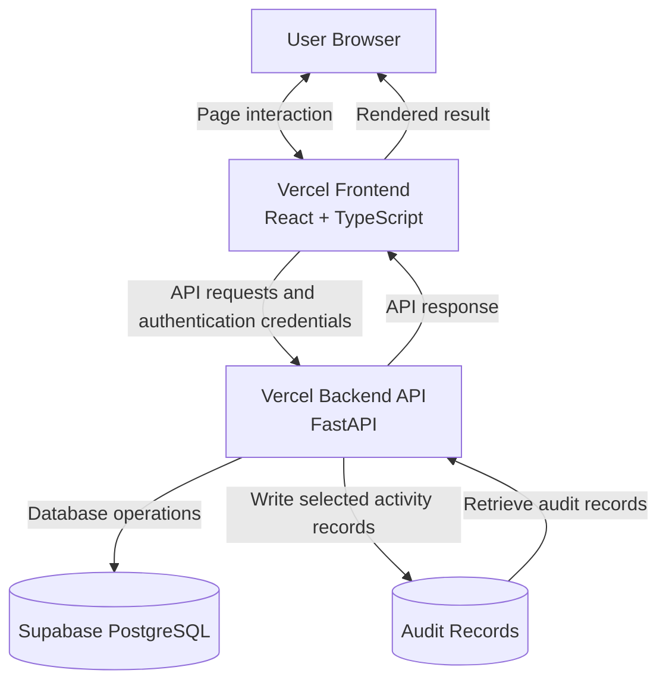
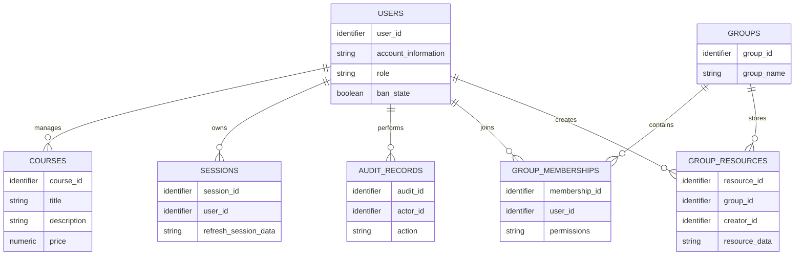
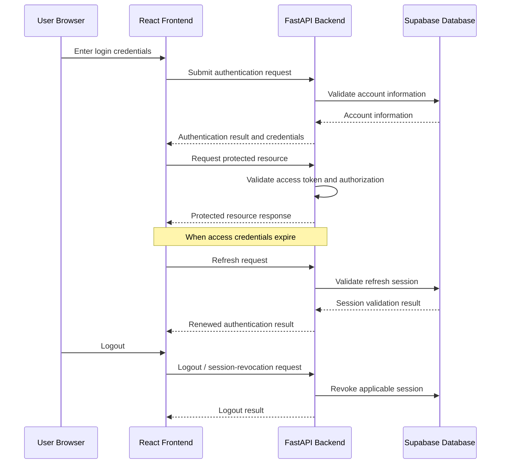
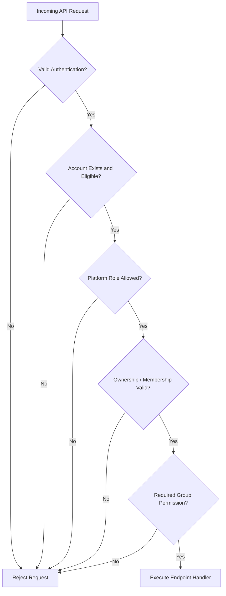
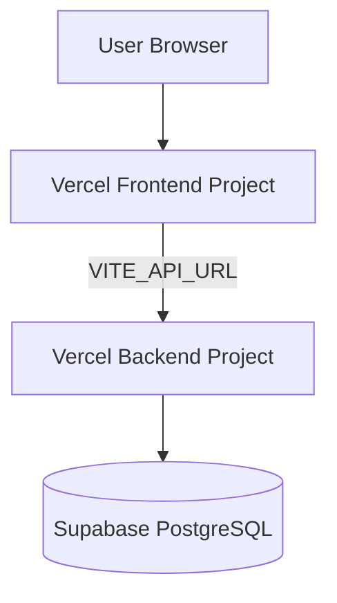

# Saints Nexus - Final Project Report

**Final project report: Saints Nexus - E-Learning Website.** This report describes the code inspected on the main branch; it does not claim that unimplemented assessment requirements are complete.

## Cover Information

| Field | Details |
|---|---|
| Project | Saints Nexus - E-Learning Website |
| Course | CSE309 - Web Applications & Internet |
| Section | 6 |
| Institution | Independent University, Bangladesh (IUB) |
| Student name | Md. Redwanur Rahman |
| Student ID | 2110400 |
| Faculty | Sayef Reyadh (Adjunct Lecturer, Department of Computer Science & Engineering, Independent University, Bangladesh) |
| Submission date | 28 November 2026 |
| Repository | https://github.com/Pistol-Saint/2110400-S6-SaintsNexus |
| Live frontend | https://2110400-saintsnexus-frontend.vercel.app/ |
| Live API | https://2110400-saintsnexus-backend.vercel.app/api/health |
| API documentation | https://2110400-saintsnexus-backend.vercel.app/docs |

---

# Table of Contents

1. [Executive Summary](#1-executive-summary)
   - [1.1 Project Overview](#11-project-overview)
   - [1.2 What Was Built Since the Mid Assessment](#12-what-was-built-since-the-mid-assessment)
   - [1.3 Live Links](#13-live-links)
2. [Part A. Product Requirements Document (PRD)](#part-a-product-requirements-document-prd)
   - [A1. Problem Statement](#a1-problem-statement)
   - [A2. Users and Roles](#a2-users-and-roles)
   - [A3. Goals and Success Measures](#a3-goals-and-success-measures)
   - [A4. Scope and Non-Goals](#a4-scope-and-non-goals)
   - [A5. User Stories](#a5-user-stories)
3. [Part B. Software Requirements Specification (SRS)](#part-b-software-requirements-specification-srs)
   - [B1. Introduction](#b1-introduction)
   - [B2. Functional Requirements](#b2-functional-requirements)
   - [B3. Non-Functional Requirements](#b3-non-functional-requirements)
   - [B4. Roles and Permission Matrix](#b4-roles-and-permission-matrix)
   - [B5. Use Cases](#b5-use-cases)
   - [B6. Acceptance Criteria](#b6-acceptance-criteria)
   - [B7. Traceability Matrix](#b7-traceability-matrix)
4. [Part C. Technical Design Document (TDD)](#part-c-technical-design-document-tdd)
   - [C1. Technology Stack](#c1-technology-stack)
   - [C2. System Architecture](#c2-system-architecture)
   - [C3. Backend and Frontend Structure](#c3-backend-and-frontend-structure)
   - [C4. Data Model](#c4-data-model)
   - [C5. API Design](#c5-api-design)
   - [C6. JWT Authentication Design](#c6-jwt-authentication-design)
   - [C7. RBAC Design](#c7-rbac-design)
   - [C8. Admin Dashboard Design](#c8-admin-dashboard-design)
   - [C9. Security Design and Threats](#c9-security-design-and-threats)
   - [C10. Deployment on Vercel](#c10-deployment-on-vercel)
   - [C11. Testing](#c11-testing)
5. [Part D. Evidence: Screenshots of the Running Application](#part-d-evidence-screenshots-of-the-running-application)
   - [D1. User Side](#d1-user-side)
   - [D2. Security Behaviour](#d2-security-behaviour)
   - [D3. Admin Dashboard](#d3-admin-dashboard)
   - [D4. Deployment](#d4-deployment)
   - [D5. Tests](#d5-tests)
6. [Part E. Project Management and Conclusion](#part-e-project-management-and-conclusion)
   - [E1. How to Run and Test](#e1-how-to-run-and-test)
   - [E2. GitHub Work](#e2-github-work)
   - [E3. Limitations](#e3-limitations)
   - [E4. Future Work](#e4-future-work)
   - [E5. Sources, Libraries and Tools](#e5-sources-libraries-and-tools)
7. [Conclusion](#conclusion)

---

# 1. Executive Summary

## 1.1 Project Overview

Saints Nexus is a web-based e-learning platform developed as an individual project for the CSE309 Web Applications course at Independent University, Bangladesh. The system provides a centralized environment where visitors can explore available courses, registered users can access account-related features, and administrators can manage users, courses, and platform activity. It also includes a permission-controlled collaborative workspace named PROJECT AVENGERS, where group members can create, update, view, and assign shared resources according to their assigned permissions.

The project focuses on implementing practical web application concepts, including authentication, role-based access control, server-side authorization, administrative management, audit logging, API integration, and cloud deployment.

**Technology stack:** React 19, TypeScript, Vite, React Router, Python, FastAPI, Supabase PostgreSQL, JWT-based authentication, and Vercel deployment.

## 1.2 What Was Built Since the Mid Assessment

The project was expanded beyond its initial course-management functionality through the following additions:

- **JWT Authentication:** Implemented account registration, login, protected requests, refresh-session handling, and logout functionality.
- **Role-Based Access Control (RBAC):** Added administrator and normal-user roles, server-side authorization, ownership checks, and group-level permissions.
- **Admin Dashboard:** Implemented administrative statistics, user management, role changes, ban and unban actions, and audit-log viewing.
- **Audit Logging:** Added records of selected administrative and application activities to support accountability.
- **CSV Export:** Implemented administrative data export functionality.
- **Collaborative Workspace:** Implemented the PROJECT AVENGERS group workspace with differentiated create, update, assign, and view permissions.
- **Deployment:** Deployed the frontend and backend through Vercel and connected the application to Supabase.

Dedicated failed-login analytics and comprehensive brute-force protection are not claimed as completed features.

## 1.3 Live Links

**Table 1. Project links**

| Resource | Link |
|---|---|
| GitHub Repository | https://github.com/Pistol-Saint/2110400-S6-SaintsNexus |
| Vercel Frontend | https://2110400-saintsnexus-frontend.vercel.app/ |
| Backend API Health | https://2110400-saintsnexus-backend.vercel.app/api/health |
| API Documentation | https://2110400-saintsnexus-backend.vercel.app/docs |
| Video Demonstration | To be added after uploading the final 5–8 minute demonstration |

Test account IDs and passwords are intentionally excluded from this Markdown report and the GitHub repository. They are provided only in the Appendix of the submitted PDF report.

---

# Part A. Product Requirements Document (PRD)

## A1. Problem Statement

Students and learners often need to access course information, manage their accounts, and participate in collaborative academic activities through different platforms or informal communication channels. When course information and shared learning resources are not organized in one place, users may experience difficulty locating relevant information, keeping track of shared resources, and understanding who is responsible for managing them.

Administrators also need a controlled way to manage users, maintain course information, and review important platform activities. Without clearly defined roles and permissions, unauthorized users may gain access to administrative functions or modify resources belonging to other users. These problems can affect data integrity, accountability, and the overall reliability of an online learning environment.

## A2. Users and Roles

**Table 2. Users and roles**

| Role | Who They Are | Main Tasks | What They Must Never Be Able to Do |
|---|---|---|---|
| Visitor | An individual who has not logged in | View publicly available pages and course information; register or log in | Access protected account information, administrative endpoints, or restricted group resources |
| Registered User | An authenticated platform user | Manage their profile, use permitted account features, and access authorized application resources | Access another user's private information or perform administrator-only actions |
| Group Member | A registered user who belongs to PROJECT AVENGERS | View group resources and perform actions allowed by assigned group permissions | Perform create, update, or assign actions without the corresponding permission |
| Group Owner | The designated owner of PROJECT AVENGERS | Manage the workspace and its member permissions, in addition to permitted resource actions | Allow unauthorized users to manage group membership or permissions |
| Administrator | An authorized platform administrator | Manage users, roles, bans, courses, audit records, and administrative exports | Change their own administrator role or ban another administrator through the protected user-management operation |

The system distinguishes between platform-level roles and group-level permissions. A platform administrator does not automatically receive additional group permissions merely because of their administrator status.

## A3. Goals and Success Measures

**Table 3. Goals and success measures**

| ID | Goal | Success Measure |
|---|---|---|
| G-01 | Provide reliable course browsing | Public users can retrieve the course catalogue through the application and API |
| G-02 | Provide secure account authentication | Protected endpoints reject requests without valid authentication |
| G-03 | Protect user-specific information | A user cannot access another user's restricted resources through unauthorized requests |
| G-04 | Enforce role-based administration | Normal users cannot access administrator-only operations |
| G-05 | Enforce collaborative workspace permissions | Create, update, and assign operations are independently checked against group permissions |
| G-06 | Maintain administrative accountability | Selected administrative actions generate audit records that administrators can review |

Security goals G-02 through G-05 are verified through application behavior and authorization checks. Dedicated automated coverage for every security edge case is not claimed.

## A4. Scope and Non-Goals

### In Scope

- Public course browsing.
- User registration and authentication.
- JWT-based protected API access.
- Refresh-session handling and logout.
- Profile management and password changes.
- Platform roles for administrators and normal users.
- Server-side role and permission checks.
- Course creation, retrieval, updating, and deletion.
- User administration, including role changes and ban/unban operations.
- Administrative audit-log viewing.
- CSV export functionality.
- PROJECT AVENGERS collaborative workspace.
- Group resource creation, updating, assignment, and viewing according to permissions.
- Frontend and backend deployment through Vercel.
- Supabase database integration.
- Automated backend tests and manual application verification.

### Out of Scope

- Full payment processing and subscription management.
- Live video classes and real-time conferencing.
- A complete learning management system with automated examinations and grading.
- A production-grade messaging or notification service.
- General-purpose creation and administration of unlimited groups.
- Advanced threat-detection analytics and dedicated failed-login dashboards.
- Comprehensive automated penetration testing.
- A fully featured content-moderation workflow with bulk moderation operations.

These features were excluded to keep the implementation within the available project scope and development period.

### Assumptions and Constraints

- Users access the application through a modern web browser.
- The frontend communicates with a separately deployed FastAPI backend.
- Supabase provides the hosted PostgreSQL database service.
- Vercel is used for deployment.
- Application secrets and database credentials must be configured through environment variables.
- The project was developed within the time and resource constraints of an individual university project.
- Internet access is required for the deployed application and hosted database.
- Test accounts and demonstration data are used for evaluation.

## A5. User Stories

**Table 4. User stories**

| ID | Role | User Story |
|---|---|---|
| US-01 | Visitor | As a visitor, I want to browse available courses so that I can understand what the platform offers |
| US-02 | Visitor | As a visitor, I want to register an account so that I can access protected features |
| US-03 | User | As a registered user, I want to log in securely so that I can access my account |
| US-04 | User | As a registered user, I want to update my profile so that my account information remains accurate |
| US-05 | User | As a registered user, I want to change my password so that I can maintain control over my account |
| US-06 | User | As a registered user, I want protected resources to be accessible only to authorized users so that my information remains private |
| US-07 | Group Member | As a group member, I want to view shared resources so that I can participate in collaborative work |
| US-08 | Group Member | As a group member, I want to create resources when granted permission so that I can contribute to the workspace |
| US-09 | Group Member | As a group member, I want to update resources when granted permission so that I can maintain shared information |
| US-10 | Group Owner | As a group owner, I want to assign permissions to members so that responsibilities can be distributed |
| US-11 | Administrator | As an administrator, I want to view registered users so that I can manage platform accounts |
| US-12 | Administrator | As an administrator, I want to change user roles so that platform responsibilities can be controlled |
| US-13 | Administrator | As an administrator, I want to ban or unban users so that access can be restricted when necessary |
| US-14 | Administrator | As an administrator, I want to review audit logs so that important platform activities can be monitored |
| US-15 | Administrator | As an administrator, I want to export administrative data so that I can review records outside the application |

---

# Part B. Software Requirements Specification (SRS)

## B1. Introduction

### Purpose

This Software Requirements Specification describes the functional and non-functional requirements of Saints Nexus. It defines the expected behavior of the application, its users, its security boundaries, and the relationship between requirements and implementation evidence.

### Intended Readers

- Course faculty and project evaluators.
- Developers maintaining the application.
- Testers verifying application behavior.
- Technical readers reviewing the system architecture and security design.

### Definitions

| Term | Definition |
|---|---|
| JWT | JSON Web Token, a signed token used to represent authenticated information |
| Access Token | A short-lived token presented when accessing protected API endpoints |
| Refresh Token | A credential used to obtain a new access token without repeating the login process |
| RBAC | Role-Based Access Control, a method of restricting access based on assigned roles |
| Role | A platform-level classification, such as administrator or normal user |
| Permission | Authorization to perform a specific action on a resource |
| Audit Log | A record of selected actions performed within the application |
| Ownership | The relationship between a user and a resource they are authorized to manage |
| API | Application Programming Interface, used for communication between the frontend and backend |

### References

- RFC 7519 — JSON Web Token (JWT): https://www.rfc-editor.org/rfc/rfc7519
- OWASP Application Security Verification Standard: https://owasp.org/www-project-application-security-verification-standard/
- OWASP Cheat Sheet Series: https://cheatsheetseries.owasp.org/
- FastAPI Documentation: https://fastapi.tiangolo.com/
- React Documentation: https://react.dev/
- TypeScript Documentation: https://www.typescriptlang.org/docs/
- Supabase Documentation: https://supabase.com/docs
- Vercel Documentation: https://vercel.com/docs

## B2. Functional Requirements

The following requirements describe implemented functionality and the expected behavior of the system. Where a requirement describes a security behavior that has not been independently demonstrated or automated, that distinction is recorded in the traceability and testing sections.

### Authentication Requirements

**Table 5. Authentication functional requirements**

| ID | Requirement |
|---|---|
| FR-AUTH-01 | The system shall allow a visitor to register a new user account. |
| FR-AUTH-02 | The system shall allow a registered user to authenticate using valid login credentials. |
| FR-AUTH-03 | The system shall store passwords using a password-hashing mechanism rather than plaintext storage. |
| FR-AUTH-04 | The system shall issue an access token after successful authentication. |
| FR-AUTH-05 | The system shall validate access tokens before allowing access to protected endpoints. |
| FR-AUTH-06 | The system shall support refresh-session handling for obtaining renewed access credentials. |
| FR-AUTH-07 | The system shall support logout and the associated session-revocation behavior implemented by the backend. |
| FR-AUTH-08 | The system shall allow authenticated users to update their profile information. |
| FR-AUTH-09 | The system shall allow authenticated users to change their password after providing the required credentials. |
| FR-AUTH-10 | The system shall reject authentication attempts containing invalid credentials. |
| FR-AUTH-11 | The system shall reject protected requests from banned users when the backend identifies their account as banned. |

### RBAC and Group Requirements

**Table 6. RBAC and group functional requirements**

| ID | Requirement |
|---|---|
| FR-RBAC-01 | The system shall distinguish between normal users and administrators. |
| FR-RBAC-02 | The system shall enforce authorization on the backend rather than relying exclusively on frontend visibility. |
| FR-RBAC-03 | The system shall restrict administrator-only operations to authorized administrators. |
| FR-RBAC-04 | The system shall enforce resource ownership where ownership is required. |
| FR-RBAC-05 | The system shall allow authorized PROJECT AVENGERS members to view group resources. |
| FR-RBAC-06 | The system shall check the create permission before allowing a group member to create a resource. |
| FR-RBAC-07 | The system shall check the update permission before allowing a group member to update a resource. |
| FR-RBAC-08 | The system shall check the assign permission before allowing a group member to assign a resource. |
| FR-RBAC-09 | The system shall restrict group permission management to the group owner. |
| FR-RBAC-10 | The system shall prevent an administrator from changing their own administrator role through the protected role-management operation. |
| FR-RBAC-11 | The system shall prevent an administrator from banning another administrator through the protected ban operation. |
| FR-RBAC-12 | The system shall not automatically grant platform administrators additional PROJECT AVENGERS permissions. |

### Administration Requirements

**Table 7. Administration functional requirements**

| ID | Requirement |
|---|---|
| FR-ADM-01 | The system shall provide an administrative dashboard for authorized administrators. |
| FR-ADM-02 | The system shall display user and role statistics in the administrative dashboard. |
| FR-ADM-03 | The system shall allow administrators to retrieve the registered-user list. |
| FR-ADM-04 | The system shall allow administrators to change eligible users' roles. |
| FR-ADM-05 | The system shall allow administrators to ban eligible users. |
| FR-ADM-06 | The system shall allow administrators to unban eligible users. |
| FR-ADM-07 | The system shall provide an audit-log view for authorized administrators. |
| FR-ADM-08 | The system shall record selected administrative actions in audit logs. |
| FR-ADM-09 | The system shall provide administrative CSV export functionality. |
| FR-ADM-10 | The system shall prevent normal users from accessing administrator-only user-management and audit-log operations. |

### Domain and Course Requirements

**Table 8. Domain functional requirements**

| ID | Requirement |
|---|---|
| FR-DOM-01 | The system shall provide a publicly accessible course catalogue. |
| FR-DOM-02 | The system shall allow users to retrieve an individual course when the course exists. |
| FR-DOM-03 | The system shall allow authorized administrators to create courses. |
| FR-DOM-04 | The system shall allow authorized administrators to update courses. |
| FR-DOM-05 | The system shall allow authorized administrators to delete courses. |
| FR-DOM-06 | The system shall provide a health endpoint for checking backend availability. |
| FR-DOM-07 | The system shall provide a PROJECT AVENGERS workspace for its configured members. |
| FR-DOM-08 | The system shall allow permitted group members to create workspace resources. |
| FR-DOM-09 | The system shall allow permitted group members to update workspace resources. |
| FR-DOM-10 | The system shall support resource assignment when the member has the required permission. |
| FR-DOM-11 | The system shall provide administrative CSV export functionality for the supported exported records. |

## B3. Non-Functional Requirements

**Table 9. Non-functional requirements**

| ID | Category | Requirement / Measure |
|---|---|---|
| NFR-01 | Security | Passwords must not be stored as plaintext. |
| NFR-02 | Security | Protected API operations must validate authentication and authorization on the backend. |
| NFR-03 | Security | Production secrets must be supplied through environment configuration rather than committed to source control. |
| NFR-04 | Security | Administrative operations must reject unauthorized normal-user requests. |
| NFR-05 | Security | Group resource actions must be checked against the relevant group permission. |
| NFR-06 | Performance | The application should return normal catalogue and dashboard requests without requiring a full frontend page reload. |
| NFR-07 | Usability | The interface should provide recognizable navigation and feedback for successful and unsuccessful actions. |
| NFR-08 | Reliability | Persistent application data should remain available after frontend or backend restarts because it is stored in the hosted database. |
| NFR-09 | Maintainability | Frontend and backend responsibilities should be separated into modular files and directories. |
| NFR-10 | Testability | Backend functionality should be testable through automated API tests. |
| NFR-11 | Documentation | The backend should expose API documentation through Swagger UI. |
| NFR-12 | Deployment | The frontend and backend should be deployable independently. |

Quantitative response-time guarantees, maximum pagination limits, and availability service-level agreements have not been established through formal performance testing and are therefore not claimed.

## B4. Roles and Permission Matrix

**Table 10. Endpoint groups against platform roles**

| Endpoint Group / Operation | Visitor | User | Group Member | Group Owner | Admin |
|---|---|---|---|---|---|
| Public health endpoint | Yes | Yes | Yes | Yes | Yes |
| Public course catalogue | Yes | Yes | Yes | Yes | Yes |
| Protected profile operations | No | Own | Own | Own | Own |
| Course creation | No | No | No | No | Yes |
| Course update | No | No | No | No | Yes |
| Course deletion | No | No | No | No | Yes |
| Administrative user listing | No | No | No | No | Yes |
| User role management | No | No | No | No | Yes, subject to safeguards |
| User ban/unban | No | No | No | No | Yes, subject to safeguards |
| Administrative audit logs | No | No | No | No | Yes |
| Group resource viewing | No | No | Yes | Yes | No automatic extra right |
| Group resource creation | No | No | If permitted | If permitted | No automatic extra right |
| Group resource updating | No | No | If permitted | If permitted | No automatic extra right |
| Group resource assignment | No | No | If permitted | If permitted | No automatic extra right |
| Group permission management | No | No | No | Yes | No automatic extra right |

**Note:** “Own” means the authenticated user may access only their own account information or resources within the applicable operation. Group access is determined by membership and the relevant permission, not by platform role alone.

### Table 11. PROJECT AVENGERS group permissions

The following table represents the configured demonstration permission assignments.

| Member | Create | Update | Assign | View |
|---|---|---|---|---|
| saints_adminX — Group Owner | Yes | Yes | Yes | Yes |
| saints_userZ | Yes | Yes | No | Yes |
| saints_userZ2 | No | No | Yes | Yes |
| saints_userZ3 | No | No | No | Yes |

**Permission definitions:**

- **Create:** Allows a member to create a new group resource.
- **Update:** Allows a member to update an existing group resource within the applicable authorization rules.
- **Assign:** Allows a member to perform the supported resource-assignment action.
- **View:** Allows a member to view resources in the group.
- **Owner-only management:** The group owner controls member permission assignments and the group-management operations implemented for the workspace.

### Table 12. Administrative safeguards

| Rule | Expected Behavior |
|---|---|
| Administrator changes own role | Rejected |
| Administrator bans another administrator | Rejected |
| Normal user accesses administrator endpoint | Rejected |
| Banned user sends a protected request | Rejected when the backend checks the user's current account status |
| Platform administrator accesses group resources | No automatic group-level permission is granted |
| Group owner changes member permissions | Allowed through the owner-authorized group operation |
| Group member changes another member's permissions | Not permitted |

## B5. Use Cases

### Use Case Diagram



### Table 13. Use-case descriptions

#### UC-01: Register and Log In

- **Actor:** Visitor.
- **Preconditions:** The visitor can access the application.

**Main Flow:**

1. The visitor opens the registration or login page.
2. The visitor enters the required information.
3. The frontend submits the request to the backend.
4. The backend validates the supplied information.
5. The backend creates the account or authenticates the existing user.
6. The application displays the appropriate result.

**Alternative / Error Flows:**

- Invalid credentials are rejected.
- Invalid registration data is rejected.
- A request without required fields receives a validation error.

**Expected Status Codes:** 200 or 201 for successful operations, 401 for authentication failure, and 422 for request validation failure where applicable.

**Postconditions:** The user account is created or the user is authenticated.

#### UC-02: Refresh an Authenticated Session

- **Actor:** Authenticated user.
- **Preconditions:** The user has an existing refreshable session.

**Main Flow:**

1. The frontend detects that an access token is no longer accepted.
2. The frontend submits the refresh request.
3. The backend validates the refresh credential and its associated session.
4. The backend issues renewed authentication credentials according to the configured rotation behavior.
5. The frontend updates its authentication state.

**Alternative / Error Flows:**

- An invalid, expired, or revoked refresh credential is rejected.
- The frontend requires the user to authenticate again if renewal fails.

**Expected Status Codes:** Successful status according to the refresh endpoint; 401 for an invalid or expired credential.

**Postconditions:** A valid session is renewed or the user must log in again.

#### UC-03: Create a Course Record

- **Actor:** Administrator.
- **Preconditions:** The administrator is authenticated and authorized.

**Main Flow:**

1. The administrator opens the course-management interface.
2. The administrator enters course information.
3. The frontend submits the request.
4. The backend validates the administrator's authorization.
5. The backend creates the course record.
6. The frontend displays the updated result.

**Alternative / Error Flows:**

- An unauthenticated request is rejected.
- A normal user is denied.
- Invalid input is rejected.

**Expected Status Codes:** 201 for successful creation, 401 for missing or invalid authentication, 403 for insufficient authorization, and 422 for validation failure.

**Postconditions:** The course is stored and available through the supported catalogue operation.

#### UC-04: Change a Group Member's Permissions

- **Actor:** PROJECT AVENGERS group owner.
- **Preconditions:** The owner is authenticated and the target member belongs to the group.

**Main Flow:**

1. The owner opens the group workspace.
2. The owner selects a member.
3. The owner changes the relevant permission.
4. The frontend submits the permission update.
5. The backend verifies the owner's authority.
6. The backend saves the updated permission.
7. The application displays the updated permission state.

**Alternative / Error Flows:**

- A non-owner attempts the operation and is rejected.
- An invalid member or permission is rejected.

**Expected Status Codes:** Successful status according to the implemented operation, 401 for unauthenticated requests, 403 for insufficient permission, and 404 where the target does not exist.

**Postconditions:** The member's permission state is updated.

#### UC-05: Denied Group Action

- **Actor:** Group member.
- **Preconditions:** The member is authenticated and belongs to PROJECT AVENGERS but lacks the permission required for the selected action.

**Main Flow:**

1. The member attempts an operation such as assigning a resource.
2. The frontend sends the request.
3. The backend checks the member's group permission.
4. The backend rejects the operation.
5. The frontend displays the authorization error.

**Alternative / Error Flows:**

- If the member has the required permission, the operation proceeds.
- If the user is not authenticated, authentication is required.

**Expected Status Codes:** 403 for insufficient permission and 401 for missing or invalid authentication.

**Postconditions:** The unauthorized action is not performed.

#### UC-06: Ban a User

- **Actor:** Administrator.
- **Preconditions:** The administrator is authenticated and the target is an eligible normal user.

**Main Flow:**

1. The administrator opens user management.
2. The administrator selects a user.
3. The administrator performs the ban action.
4. The backend verifies administrator privileges and safeguard rules.
5. The backend updates the target user's ban state.
6. The action is recorded where audit logging applies.
7. The interface displays the updated state.

**Alternative / Error Flows:**

- A normal user is denied.
- The administrator attempts to ban another administrator and is rejected.
- The target user does not exist and the operation is rejected.

**Expected Status Codes:** Successful status according to the implemented operation, 401 for missing authentication, 403 for a prohibited action, and 404 for a missing target.

**Postconditions:** The eligible user's ban state is updated.

#### UC-07: Read the Audit Log

- **Actor:** Administrator.
- **Preconditions:** The administrator is authenticated.

**Main Flow:**

1. The administrator opens the audit-log interface.
2. The frontend requests the audit-log records.
3. The backend verifies administrator authorization.
4. The backend retrieves the supported audit records.
5. The frontend displays the results.

**Alternative / Error Flows:**

- A normal user is denied.
- An invalid query or limit is rejected where validation applies.

**Expected Status Codes:** 200 for success, 401 for missing or invalid authentication, and 403 for insufficient authorization.

**Postconditions:** The administrator can review the available audit records.

## B6. Acceptance Criteria

**Table 14. Acceptance criteria**

| ID | Given | When | Then |
|---|---|---|---|
| AC-01 | A visitor has no valid access token | They request a protected endpoint | The backend rejects the request with 401 |
| AC-02 | A user submits an invalid or tampered token | They request a protected endpoint | The backend rejects the token |
| AC-03 | A user attempts to access another user's restricted resource | The request reaches the backend | The backend denies access and does not disclose the protected resource |
| AC-04 | A group member lacks the required create permission | They submit a create request | The backend denies the operation with 403 |
| AC-05 | A group member lacks the required update permission | They submit an update request | The backend denies the operation with 403 |
| AC-06 | A group member lacks the required assign permission | They submit an assignment request | The backend denies the operation with 403 |
| AC-07 | A user has been banned | They send another protected request | The backend rejects the request after checking the current account status |
| AC-08 | An administrator attempts to change their own role | They submit the role-management request | The backend rejects the operation |
| AC-09 | An administrator attempts to ban another administrator | They submit the ban request | The backend rejects the operation |
| AC-10 | A normal user requests administrative user data | They call the administrative endpoint | The backend denies access |
| AC-11 | An authorized administrator requests audit records | They call the audit-log endpoint | The backend returns the permitted records |
| AC-12 | An authorized administrator requests a CSV export | They use the supported export operation | The application generates the supported export |

**Verification note:** These criteria define the required behavior. They should not be interpreted as proof that every criterion has a dedicated automated test. The testing section distinguishes automated coverage from manual verification and unverified scenarios.

## B7. Traceability Matrix

**Table 15. Requirement traceability**

| Requirement Group | Endpoint / Screen | Automated Test / Verification | Evidence |
|---|---|---|---|
| FR-AUTH-01 to 03 | Registration and login screens; auth router | Password hashing and incorrect-password tests; registration/login manual verification | S1 |
| FR-AUTH-04 to 07 | Authentication service and protected API operations | Authentication-required test; session behavior manual verification | S4, S7, S8 |
| FR-AUTH-08 to 09 | Profile page | Manual profile and password-change verification | S3 |
| FR-AUTH-10 to 11 | Authentication and protected endpoints | Incorrect-password test; banned-user behavior requires live verification | S1, S9 |
| FR-RBAC-01 to 03 | Admin dashboard and admin router | Course authorization and admin endpoint tests | S10, S11 |
| FR-RBAC-04 | Resource ownership checks | Ownership-specific manual verification unless separately covered by the current test suite | S2 |
| FR-RBAC-05 to 09 | PROJECT AVENGERS workspace and group router | Group permission matrix manual verification | S5, S6 |
| FR-RBAC-10 to 12 | Admin and group authorization operations | Admin safeguard manual verification | S13 |
| FR-ADM-01 to 02 | Admin dashboard | Manual dashboard verification | S10 |
| FR-ADM-03 to 06 | Admin user-management interface | Manual user-management verification | S11, S13 |
| FR-ADM-07 to 08 | Audit-log page and admin router | Audit endpoint verification | S15 |
| FR-ADM-09 | CSV export interface and backend export operation | Manual CSV export verification | S17 |
| FR-DOM-01 to 02 | Course catalogue and course detail operations | Course retrieval and missing-course tests | Course page |
| FR-DOM-03 to 05 | Course-management operations | Authorization and course-creation tests; update/delete manual verification | Course-management evidence |
| FR-DOM-06 | `/api/health` | Health endpoint test | S20 |
| FR-DOM-07 to 10 | PROJECT AVENGERS workspace | Manual group permission verification | S5, S6 |
| NFR-01 to 05 | Backend authentication and authorization code | Password and authorization tests; security review | S7–S9 |
| NFR-06 to 12 | Frontend, API, deployment, and documentation | Build, test, and live-service verification | S18–S21 |

The final screenshot references and test names should be adjusted to match the actual submitted evidence and current automated test output.

---

# Part C. Technical Design Document (TDD)

## C1. Technology Stack

**Table 16. Technology stack**

| Component | Technology | Version / Configuration | Reason |
|---|---|---|---|
| Frontend framework | React | 19 | Component-based user interface |
| Frontend language | TypeScript | Project-configured version | Type safety and maintainability |
| Build tool | Vite | Project-configured version | Development server and production builds |
| Routing | React Router | Project-configured version | Client-side navigation |
| Backend framework | FastAPI | Project-configured version | Python API development and automatic API documentation |
| Backend language | Python | Local tested runtime: 3.15.0 | Backend application logic |
| Database | Supabase PostgreSQL | Hosted Supabase project | Relational data persistence |
| Authentication | JWT-based authentication | Backend configuration | Protected API access |
| Password hashing | Argon2-based password hashing | Installed backend dependency | Password protection |
| API testing | Pytest | Installed project version | Automated backend testing |
| API documentation | Swagger UI / OpenAPI | FastAPI-generated | Endpoint inspection and testing |
| Version control | Git and GitHub | Project repository | Source control and collaboration workflow |
| Hosting | Vercel | Production deployment | Frontend and backend hosting |

The project uses Supabase's PostgreSQL database service through its configured backend integration. An ORM is not identified as a project dependency in this report.

## C2. System Architecture

### Architecture Diagram



### Architecture Explanation

**Browser to Frontend:** The user opens the deployed Saints Nexus frontend through a web browser. The browser loads the React application and displays the available pages.

**Frontend to Backend:** The frontend communicates with the FastAPI backend through HTTP API requests. Protected operations use the authentication mechanism implemented by the frontend authentication service and backend.

**Backend to Database:** The backend performs the database operations required by the application. Supabase PostgreSQL provides persistent storage.

**Backend to Audit Records:** Selected administrative and application actions are recorded through the audit functionality. Administrators can retrieve the available records through the administrative interface.

**Backend to Frontend:** The API returns operation results or error responses. The frontend uses these responses to update the interface and display feedback.

**Frontend to Browser:** React renders the returned application state, including course information, user information, administrative data, and group resources.

**Important implementation distinction:** The current design is not documented as an HttpOnly-cookie refresh-token architecture. The authentication flow must be described according to the actual frontend and backend implementation; a cookie-based refresh mechanism must not be assumed.

## C3. Backend and Frontend Structure

The following trees summarize the known project organization. They are not intended to replace the complete directory listing in the source repository.

### Backend Folder Structure

```text
backend/
├── main.py
├── database.py
├── routers/
│   ├── auth.py
│   ├── admin.py
│   └── groups.py
├── tests/
│   └── test_api.py
└── requirements.txt
```

**Backend responsibilities:**

- `main.py`: Creates the FastAPI application, configures application-level middleware and routes, and exposes the API.
- `database.py`: Provides the database integration used by backend operations.
- `routers/auth.py`: Handles authentication-related API functionality.
- `routers/admin.py`: Contains administrative operations, including user management and audit-log functionality.
- `routers/groups.py`: Handles the PROJECT AVENGERS group workspace and its resource operations.
- `tests/test_api.py`: Contains automated backend API tests.
- `requirements.txt`: Lists the Python dependencies required by the backend.

### Frontend Folder Structure

```text
frontend/
├── src/
│   ├── context/
│   │   └── AuthContext.tsx
│   ├── pages/
│   │   └── BasicPages.tsx
│   ├── services/
│   │   ├── api.ts
│   │   └── authService.ts
│   ├── types/
│   │   └── auth.ts
│   └── App.tsx
├── .env.local
├── package.json
└── vite.config.ts
```

**Frontend responsibilities:**

- `App.tsx`: Main application entry point and application-level routing.
- `context/AuthContext.tsx`: Provides authentication state and related context to frontend components.
- `pages/BasicPages.tsx`: Contains the relevant account and administrative page components.
- `services/api.ts`: Provides the frontend API communication layer.
- `services/authService.ts`: Handles authentication-related frontend service operations.
- `types/auth.ts`: Defines authentication-related TypeScript types.
- `.env.local`: Contains local frontend environment configuration, including the backend API URL.
- `package.json`: Defines frontend dependencies and scripts.

The project contains additional application components and files beyond this summarized tree. The repository is the source of truth for the complete structure.

## C4. Data Model

### Conceptual Entity Relationship Diagram



### Data Model Explanation

The diagram is a conceptual representation of the application's logical data relationships. It is not a claim that the deployed Supabase project uses these exact physical table names or column definitions.

The confirmed course data includes:

| Field | Purpose |
|---|---|
| id | Course identifier |
| created_at | Course creation timestamp |
| title | Course title |
| description | Course description |
| price | Course price |

The title field was configured as nullable in the Supabase table setup.

The application's other data categories include:

- User account and profile information.
- Authentication and refresh-session information.
- User roles and ban state.
- Administrative audit records.
- PROJECT AVENGERS membership and permission information.
- Group workspace resources.

### Physical Schema Documentation

The complete physical schema must be documented from the actual deployed Supabase database before final PDF submission.

For every actual table, record:

| Schema Item | Information Required |
|---|---|
| Table name | Exact name in Supabase |
| Column | Exact column name |
| Data type | Actual PostgreSQL data type |
| Primary key | Actual primary-key field |
| Foreign key | Referenced table and field |
| Nullable | Whether NULL is allowed |
| Default | Configured default value |
| Constraint | Actual check, unique, or other constraint |
| Index | Actual index name and indexed columns |

Do not substitute the conceptual entities above for the actual database schema. The final report should use the real Supabase table definitions and relationships.

## C5. API Design

The backend exposes its API under the `/api` prefix. Swagger UI is available at:

https://2110400-saintsnexus-backend.vercel.app/docs

The following table lists the confirmed application routes. Authentication and role requirements should be checked against the current router implementation and deployed OpenAPI specification before final submission.

### Health and Course Endpoints

| Method | Path | Authentication / Role | Purpose |
|---|---|---|---|
| GET | `/api/health` | Public | Check backend health |
| GET | `/api/hello` | Public | Return the API hello response |
| GET | `/api/courses` | Public | Retrieve the course catalogue |
| GET | `/api/courses/{course_id}` | Public | Retrieve an individual course |
| POST | `/api/courses` | Administrator | Create a course |
| PUT | `/api/courses/{course_id}` | Administrator | Update a course |
| DELETE | `/api/courses/{course_id}` | Administrator | Delete a course |

### Group Endpoints

| Method | Path | Authentication / Permission | Purpose |
|---|---|---|---|
| GET | `/api/groups/project-avengers` | Authenticated group member | Retrieve the configured group |
| GET | `/api/groups/project-avengers/resources` | Authenticated group member with view access | Retrieve group resources |
| POST | `/api/groups/project-avengers/resources` | Group member with create permission | Create a group resource |
| PUT | `/api/groups/project-avengers/resources/{resource_id}` | Group member with update permission | Update a group resource |
| PATCH | `/api/groups/project-avengers/resources/{resource_id}/assign` | Group member with assign permission | Assign a group resource |

### Administrative Endpoints

| Method | Path | Authentication / Role | Purpose |
|---|---|---|---|
| GET | `/api/admin/users` | Administrator | Retrieve users |
| PATCH | `/api/admin/users/{user_id}/role` | Administrator, subject to safeguards | Change a user's role |
| PATCH | `/api/admin/users/{user_id}/ban` | Administrator, subject to safeguards | Ban an eligible user |
| PATCH | `/api/admin/users/{user_id}/unban` | Administrator | Unban a user |
| GET | `/api/admin/audit-logs?limit=100` | Administrator | Retrieve audit records |

### Authentication Endpoints

Authentication routes are implemented in the authentication router. Their exact paths and request schemas must be taken from the current deployed Swagger/OpenAPI documentation rather than inferred or invented.

### CSV Export

CSV export is available through the administrative interface and its corresponding backend functionality. Its exact route, request parameters, and response headers should be copied from the deployed API documentation.

### Request and Response Format

The API uses HTTP methods and JSON request/response bodies where applicable.

A successful response returns the appropriate result for the requested operation. Errors use HTTP status codes to communicate conditions such as:

- **200 OK** — Successful retrieval or operation.
- **201 Created** — Successful resource creation.
- **401 Unauthorized** — Authentication missing, invalid, or expired.
- **403 Forbidden** — Authenticated user lacks the required permission.
- **404 Not Found** — Requested resource does not exist.
- **422 Unprocessable Entity** — Request validation failure.
- **500 Internal Server Error** — Unexpected server-side failure.

The exact error-response JSON structure should be copied from the deployed API response examples before final submission.

## C6. JWT Authentication Design

Saints Nexus uses JWT-based authentication to protect application endpoints and maintain authenticated user sessions.

### Authentication Flow



### Token Claims and Configuration

| Item | Description |
|---|---|
| User identifier | Identifies the authenticated account |
| Role information | Used by the authorization system where included in the token or retrieved from current account state |
| Issued-at information | Records when the token was issued |
| Expiration | Determines when the token is no longer valid |
| Signing algorithm | Defined by the backend JWT configuration |
| Signing secret | Supplied through backend environment configuration |
| Refresh-session information | Used to validate and manage refreshable sessions |

The exact algorithm, claim names, and token lifetimes must be recorded from the actual backend configuration. They should not be guessed or replaced with generic example values.

### Token Lifetimes

Access tokens are intended to be short-lived, while refresh sessions support renewal without requiring the user to repeat the login process.

The exact configured durations are implementation-specific and must be copied from the backend configuration into the final submitted PDF.

### Browser Storage and Security Considerations

The application uses a frontend authentication service and authentication context to manage authentication state.

The implementation should be documented according to the actual storage behavior in `frontend/src/services/authService.ts` and `frontend/src/context/AuthContext.tsx`.

The current report does not claim that refresh tokens are stored in HttpOnly cookies. Therefore, an HttpOnly-cookie screenshot or cookie-based security claim must not be presented as evidence unless the implementation is changed and verified.

Relevant risks include:

- **Cross-Site Scripting (XSS):** Malicious scripts may attempt to access browser-managed authentication information.
- **Cross-Site Request Forgery (CSRF):** Cookie-based authentication may require additional CSRF protections.
- **Token theft:** A stolen access or refresh credential may be misused until it expires or is revoked.

### Server-Side Validation

Protected backend operations should validate the token's signature and expiration and verify the associated account's authorization status.

The backend must also enforce role and permission checks. Frontend route guards and hidden buttons are not substitutes for backend authorization.

### Frontend Behavior on Authentication Failure

The frontend authentication service is responsible for handling failed protected requests and session renewal according to the implemented refresh flow.

The final report should describe the exact retry behavior observed in the current implementation. Do not claim a guaranteed single-refresh retry and automatic logout sequence unless verified in the deployed application.

## C7. RBAC Design

Role-Based Access Control determines whether a user may perform an operation.

### Authorization Flow



### Platform Roles

- Visitor: No authenticated account.
- User: Normal registered account.
- Administrator: Authorized platform administrator.
- Group Owner: Owner of PROJECT AVENGERS.
- Group Member: Member of PROJECT AVENGERS with assigned permissions.

Group ownership and membership permissions are separate from platform-level administrator privileges.

### Group Permission Definitions

| Permission | Purpose |
|---|---|
| view | View group resources |
| create | Create a group resource |
| update | Update an existing group resource |
| assign | Assign a resource |
| Owner management | Manage the group's member permissions through the owner-authorized operation |

### Authorization Principles

1. Authenticate the incoming request.
2. Verify the account and its current eligibility.
3. Check the required platform role.
4. Verify resource ownership or group membership.
5. Check the required group permission.
6. Execute the operation only after all applicable checks succeed.

### Ownership Enforcement

Ownership must be enforced by backend authorization and resource-selection logic. A frontend-only ownership check is insufficient.

Where a resource belongs to a particular user, the backend should ensure that the authenticated user's identifier is part of the authorization condition used to retrieve or modify that resource.

### Adding a New Role or Permission

To add a role or permission safely:

1. Define the new role or permission in the backend authorization design.
2. Update the relevant backend validation and permission checks.
3. Update the affected endpoint authorization requirements.
4. Update the frontend types and presentation logic.
5. Add tests for both permitted and denied operations.
6. Update the permission matrix and traceability table.

### Administrative Safeguards

The administrator-management implementation includes protections against changing one's own administrator role and banning another administrator. Platform-level administrator status does not automatically grant additional PROJECT AVENGERS group permissions.

### Reusable Authorization Logic

The backend authorization checks are implemented within the relevant router and supporting authentication/permission logic.

The following is illustrative pseudocode, not a copied source-code excerpt:

```python
def authorize_group_action(user, group, action):
    if user is None:
        raise UnauthorizedError()

    if user.is_banned:
        raise ForbiddenError()

    membership = find_membership(user.id, group.id)

    if membership is None:
        raise ForbiddenError()

    if not membership.has_permission(action):
        raise ForbiddenError()

    return True
```

The exact source-code excerpt for the final submission should be copied from the current authorization implementation. This example explains the intended authorization sequence and must not be presented as a verbatim source file.

## C8. Admin Dashboard Design

The administrative dashboard provides platform-level management functionality.

### Administrative Pages and Features

| Page / Feature | Functionality | Verification |
|---|---|---|
| Dashboard Overview | Displays available platform statistics, including user and role counts | Manual interface verification |
| User Management | Displays registered users | Manual interface verification |
| Role Management | Changes eligible users' roles | Manual action verification |
| Ban Management | Bans and unbans eligible users | Manual action verification |
| Audit Logs | Displays recorded administrative activity | Manual interface and API verification |
| CSV Export | Exports supported administrative data | Download and file-opening verification |

### User List Behavior

The administrative user interface provides a user listing with available search and filtering behavior. Search and filtering should not be described as fully server-side unless confirmed by the backend implementation.

The final report should distinguish between frontend-side filtering and backend query filtering.

### Administrative Actions and Audit Events

| Action | Expected Result | Audit Logging |
|---|---|---|
| Change user role | Eligible user's role is updated | Selected action is recorded |
| Ban user | Eligible user's ban state is updated | Selected action is recorded |
| Unban user | User's ban state is restored | Selected action is recorded |
| Review audit logs | Available records are displayed | Reading the log should not be assumed to create a new event |
| Export CSV | Supported data is exported | Export logging should be claimed only if verified |

### Bulk Actions and Advanced Analytics

The implementation does not claim a comprehensive bulk-action framework or a complete failed-login security analytics page.

Therefore, the report does not claim:

- A bulk-action summary reporting affected and skipped record counts.
- Advanced content moderation with bulk actions.
- Failed-login analytics grouped by IP address and account.
- A complete security dashboard with threat analytics.

These are recorded as future work where appropriate.

## C9. Security Design and Threats

**Table: Security threats and defenses**

| Threat | Defense / Current Approach | Location / Verification |
|---|---|---|
| Password database leak | Passwords are stored using password hashing rather than plaintext | Authentication implementation; password hashing test |
| Stolen access token | Token validation and expiration limit unauthorized use | Authentication implementation |
| Stolen refresh token | Refresh-session validation and revocation mechanisms | Authentication/session implementation |
| Brute-force login | No dedicated production-grade rate-limiting or lockout mechanism is claimed | Future security improvement |
| Privilege escalation | Backend role checks and administrator safeguards | Admin router and authorization implementation |
| Access to another user's record | Ownership checks must restrict access to authorized resources | Relevant protected resource operations |
| Cross-Site Scripting | Frontend should avoid unsafe HTML injection and validate untrusted content | Frontend review; comprehensive security testing not claimed |
| Cross-Site Request Forgery | Cookie-specific CSRF defenses are not claimed because the report does not document an HttpOnly-cookie authentication design | Authentication architecture |
| CORS misuse | Backend CORS configuration restricts allowed frontend origins | FastAPI application configuration |
| Secrets in repository | Production secrets must remain in environment configuration and outside committed files | Deployment configuration and repository review |
| SQL injection | Database access should use parameterized or safely structured database operations | Database integration review |
| Over-posting of fields | Backend request validation and restricted update fields should prevent unauthorized field changes | Relevant request schemas and router logic |

### Security Limitations

The project demonstrates authentication, authorization, and administrative safeguards but is not represented as a fully security-audited production system.

A dedicated brute-force protection system, comprehensive XSS/CSRF testing, full penetration testing, and advanced failed-login analytics remain outside the verified implementation scope.

## C10. Deployment on Vercel

### Deployment Overview

Saints Nexus is deployed using separate frontend and backend projects.

**Frontend production URL:**

https://2110400-saintsnexus-frontend.vercel.app/

**Backend production URL:**

https://2110400-saintsnexus-backend.vercel.app/

**Backend API documentation:**

https://2110400-saintsnexus-backend.vercel.app/docs

### Deployment Diagram



### Frontend Configuration

- Frontend project: `2110400-saintsnexus-frontend`
- Root directory: `frontend`
- Build system: Vite
- Production domain: https://2110400-saintsnexus-frontend.vercel.app/
- API address: Configured through `VITE_API_URL`

### Backend Configuration

- Backend project: `2110400-saintsnexus-backend`
- Framework: FastAPI
- Database: Supabase PostgreSQL
- Production API base: https://2110400-saintsnexus-backend.vercel.app

### Environment Variables

**Table: Environment variable names and purposes**

| Variable | Purpose |
|---|---|
| `VITE_API_URL` | Frontend API base URL |
| Supabase URL variable configured by backend | Identifies the Supabase project |
| Supabase key variable configured by backend | Provides the backend's configured Supabase access |
| JWT signing-secret variable configured by backend | Supplies the authentication signing secret |
| Other backend configuration variables | Must match the actual backend environment configuration |

The exact names of the Supabase and JWT variables must be copied from the backend configuration and Vercel project settings. Their values must never be included in the report or screenshots.

### Local Frontend Environment

The local frontend uses:

```env
VITE_API_URL=http://127.0.0.1:8002
```

### Redeployment

1. Commit the verified changes to the GitHub repository.
2. Push the changes to the appropriate branch.
3. Confirm the relevant Vercel project is connected to the repository.
4. Allow Vercel to build and deploy the updated project.
5. Check the production deployment status.
6. Verify the frontend and backend URLs.
7. Test the API health endpoint and Swagger documentation.
8. Verify that the frontend communicates with the deployed API.

## C11. Testing

### Test Strategy

Testing was performed through a combination of automated backend tests, frontend production builds, API inspection, and manual application verification.

Automated tests verify selected backend behaviors. Manual verification was used for additional frontend workflows, administrative operations, and group permission behavior.

### Commands

**Run backend tests:**

```powershell
python -m pytest backend\tests -v
```

**Build the frontend:**

```powershell
npm run build --prefix frontend
```

### Previously Recorded Automated Results

The following backend test categories were previously verified:

| Test | Requirement | Recorded Result |
|---|---|---|
| Health endpoint | FR-DOM-06 | Passed |
| Sample API response | API availability | Passed |
| Course retrieval | FR-DOM-01 / FR-DOM-02 | Passed |
| Missing course response | FR-DOM-02 | Passed |
| Course creation authorization | FR-DOM-03 / FR-RBAC-03 | Passed |
| Administrator course creation | FR-DOM-03 | Passed |
| Password hashing | FR-AUTH-03 | Passed |
| Incorrect password rejection | FR-AUTH-10 | Passed |
| Authentication required for protected endpoint | FR-AUTH-05 | Passed |

A previous recorded backend test run completed with 9 passed tests.

A previous frontend production build completed successfully using `npm run build --prefix frontend`.

### Additional Manual Verification

| Test Area | Verification |
|---|---|
| User dashboard | Dashboard access and interface behavior checked |
| Profile management | Username/profile editing checked |
| Password change | Password-change workflow checked |
| Admin dashboard | User and role statistics displayed |
| User management | Role change and ban/unban operations checked |
| Audit logs | Administrative audit records retrieved |
| Group workspace | PROJECT AVENGERS resources and permission behavior checked |
| CSV export | Export functionality implemented and available for manual verification |
| Swagger | Deployed API documentation opened and inspected |
| Deployment | Frontend and backend production URLs checked |

### Security Tests Not Claimed as Automated

The following scenarios must be separately verified or added to the automated test suite before being reported as passed:

- Access-token expiration returning 401.
- Tampered JWT rejection.
- Cross-user ownership denial.
- Every create/update/assign group permission combination.
- Banned-user rejection on the next protected request.
- Administrator self-role-change prevention.
- Administrator-to-administrator ban prevention.
- Dedicated brute-force lockout behavior.
- Failed-login analytics by IP and account.

### Final Test Evidence

The final PDF should contain the actual output from a fresh test run. Historical test results should not replace a new execution of the test suite immediately before submission.

---

# Part D. Evidence: Screenshots of the Running Application

All screenshots should be captured from the deployed Vercel application wherever the relevant feature is available.

Each screenshot should:

- Show the browser address bar.
- Show the logged-in account where appropriate.
- Be cropped to the relevant interface.
- Mask passwords, access tokens, refresh tokens, API keys, and other secrets.
- Include a numbered caption and the requirement ID it supports.
- Use real application data rather than fabricated evidence.

## D1. User Side

### S1 — Signup and Login Page

- Show the registration and login interface.
- Include a real validation error, such as a rejected weak password, if supported.
- Requirements: FR-AUTH-01, FR-AUTH-02, FR-AUTH-10.

### S2 — Logged-In User Main Feature Page

- Show the main feature page for a logged-in user.
- Demonstrate that the displayed restricted records belong to the current user.
- Requirements: FR-AUTH-05, FR-RBAC-04.

### S3 — Profile and Password Change

- Show the profile page.
- Show the password-change form.
- Demonstrate rejection of an incorrect current password if supported by the live application.
- Requirements: FR-AUTH-08, FR-AUTH-09.

### S4 — Session Management

- Show the available session-management interface and revoke action if exposed by the application.
- Requirements: FR-AUTH-06, FR-AUTH-07.

If a dedicated session list and revoke interface is not available in the current frontend, report it as a limitation rather than presenting an unrelated screen.

### S5 — PROJECT AVENGERS Group Page

- Show the group name.
- Show the group members.
- Show the configured create, update, assign, and view permissions.
- Requirements: FR-RBAC-05 to FR-RBAC-09.

### S6 — RBAC Denied Action

- Show a member attempting an action they are not permitted to perform.
- Show the application error and the corresponding 403 response in the browser Network tab.
- Requirements: FR-RBAC-06 to FR-RBAC-08.

## D2. Security Behaviour

### S7 — Protected Request and Authorization Header

- Show a protected API request in the Network tab.
- Mask the token value.
- Show the authorization header and an expired-token 401 response only if this behavior is verified.
- Requirements: FR-AUTH-05.

### S8 — Refresh Request

- Show the refresh request and its response if supported.
- Do not claim or screenshot an HttpOnly cookie unless the application actually uses one.
- Requirements: FR-AUTH-06.

### S9 — Banned User Rejection

- Show an account that has been banned.
- Demonstrate the next protected request being rejected.
- Requirements: FR-AUTH-11, FR-ADM-05.

## D3. Admin Dashboard

### S10 — Administrative Overview Statistics

- Show the administrative dashboard overview.
- Include the visible user and role statistics.
- Requirements: FR-ADM-01, FR-ADM-02.

### S11 — User Management List

- Show the registered-user list.
- Include the available search and filter controls.
- Show pagination only if it is actually implemented.
- Requirements: FR-ADM-03.

### S12 — User Details

- Show available user details and related activity or session information if exposed.
- Do not imply that a complete security-detail page exists if it does not.
- Requirements: FR-ADM-03, FR-ADM-07.

### S13 — Ban and Unban

- Show the ban action and the resulting banned state.
- Demonstrate the administrator safeguards where possible.
- Requirements: FR-ADM-05, FR-ADM-06, FR-RBAC-10, FR-RBAC-11.

### S14 — Content and Group Moderation

- Show the available course or group-management interfaces.
- Do not label the screenshot as a bulk-moderation feature unless bulk moderation is implemented.
- Requirements: FR-DOM-03 to FR-DOM-05 and FR-RBAC-05 to FR-RBAC-09.

### S15 — Administrative Activity Log

- Show the audit-log interface.
- Include actual recorded events caused by the demonstration.
- Requirements: FR-ADM-07, FR-ADM-08.

### S16 — Failed-Login Security Analytics

- This screenshot is not available as verified implementation evidence because a dedicated failed-login analytics view grouped by IP address and account is not claimed as implemented.
- Record this as a limitation and future improvement.
- Related requirement: proposed security analytics feature, not a completed functional requirement.

### S17 — CSV Export

- Download a CSV export from the administrative interface.
- Open the downloaded file in a spreadsheet application.
- Show that the exported records are readable.
- Requirements: FR-ADM-09.

## D4. Deployment

### S18 — Vercel Frontend Project

- Show the frontend Vercel project.
- Include the production deployment and domain.
- Mask sensitive account information where necessary.

### S19 — Vercel Backend Project

- Show the backend Vercel project.
- Show the configured environment-variable names.
- Hide every environment-variable value.

### S20 — Live API Documentation

- Open the deployed Swagger UI:

  https://2110400-saintsnexus-backend.vercel.app/docs

- Show the available endpoints.

## D5. Tests

### S21 — Automated Test Output

- Run:

  ```powershell
  python -m pytest backend\tests -v
  ```

- Capture the complete output.
- Ensure the test count and final result are visible.
- Do not reuse an old test screenshot if the current source code has changed.

---

# Part E. Project Management and Conclusion

## E1. How to Run and Test

### Prerequisites

- Python installed.
- Node.js and npm installed.
- Git installed.
- A copy of the Saints Nexus repository.
- Supabase project credentials.
- Required backend environment configuration.
- A modern web browser.

### 1. Clone the Repository

```powershell
git clone https://github.com/Pistol-Saint/2110400-S6-SaintsNexus.git
cd 2110400-S6-SaintsNexus
```

### 2. Set Up the Backend

Create a virtual environment:

```powershell
python -m venv backend\.venv
```

Activate it:

```powershell
.\backend\.venv\Scripts\Activate.ps1
```

Install dependencies:

```powershell
pip install -r backend\requirements.txt
```

Configure the backend environment variables using the exact names required by the backend configuration.

Example values below are placeholders only:

```env
YOUR_SUPABASE_URL_VARIABLE=https://your-project.supabase.co
YOUR_SUPABASE_KEY_VARIABLE=YOUR_SUPABASE_KEY
YOUR_JWT_SECRET_VARIABLE=YOUR_LONG_RANDOM_SECRET
```

Replace the placeholder variable names with the exact names expected by the backend. Never commit real credentials.

Start the backend from the repository root:

```powershell
uvicorn backend.main:app --reload --port 8002
```

The local API should be available at:

http://127.0.0.1:8002

Swagger documentation:

http://127.0.0.1:8002/docs

### 3. Set Up the Frontend

Open another terminal:

```powershell
cd frontend
npm install
```

Create or update `frontend/.env.local`:

```env
VITE_API_URL=http://127.0.0.1:8002
```

Start the frontend:

```powershell
npm run dev
```

Use the local URL displayed by Vite in the terminal.

### 4. Run Backend Tests

From the repository root:

```powershell
python -m pytest backend\tests -v
```

### 5. Build the Frontend

From the repository root:

```powershell
npm run build --prefix frontend
```

### 6. Access the Deployed Application

**Frontend:**

https://2110400-saintsnexus-frontend.vercel.app/

**Backend documentation:**

https://2110400-saintsnexus-backend.vercel.app/docs

### 7. Test Accounts

Use the demonstration administrator and normal-user accounts prepared for project evaluation.

The account IDs, usernames where applicable, passwords, and roles are provided only in the Appendix of the submitted PDF report.

No test-account passwords or credentials are included in this Markdown file or the GitHub repository.

## E2. GitHub Work

The project was developed and maintained in the following repository:

https://github.com/Pistol-Saint/2110400-S6-SaintsNexus

### Known Issues, Pull Requests, Branches, and Commits

| Item | Link / Identifier | Contribution |
|---|---|---|
| Documentation Issue | Issue #2 | Tracked project documentation work |
| Documentation Pull Request | PR #1 | Added and merged project documentation |
| Documentation Branch | `feature/2-saints-nexus-docs` | Documentation development |
| Course CRUD Branch | `feature/3-course-crud-mvp` | Course functionality and deployment-related updates |
| Commit | `a8b1f0d` | Merged documentation changes |
| Commit | `51e6698` | Added deployed backend URL and related CORS configuration |
| Commit | `286acd1` | Updated CORS configuration to include the deployed frontend |

Additional project development was carried out through repository commits and feature updates. The repository's Git history provides the complete chronological record.

This was an individual project. Planning, implementation, testing, deployment, and report preparation were carried out by the submitting student.

## E3. Limitations

The following limitations are acknowledged:

1. **Dedicated Brute-Force Protection:** A complete rate-limiting and account-lockout mechanism has not been established as a verified production feature.
2. **Failed-Login Analytics:** A dedicated security view displaying failed login attempts by IP address and account is not implemented as verified functionality.
3. **Advanced User Search:** The available user-list search and filtering should not be described as fully server-side filtering unless confirmed by the backend implementation.
4. **Bulk Administration:** A comprehensive bulk-action system with affected and skipped item counts is not claimed as implemented.
5. **Advanced Content Moderation:** A full content-moderation workflow is outside the verified implementation.
6. **Session Management Interface:** The exact completeness of session-list and per-session revocation functionality should be evaluated against the current deployed frontend.
7. **Security Test Coverage:** Not every token, ownership, refresh-session, and authorization edge case has a dedicated automated test.
8. **Performance Testing:** Formal load testing and quantified performance benchmarks have not been completed.
9. **Security Audit:** The application has not undergone a comprehensive independent penetration test.
10. **General-Purpose Group Management:** The project provides the configured PROJECT AVENGERS workspace rather than a complete system for creating and managing unlimited groups.
11. **Physical Schema Documentation:** The final physical database schema must be documented directly from the current Supabase project.
12. **Deployment Configuration:** Environment-variable names and authentication configuration must be checked against the final deployed settings before submission.

These limitations are acknowledged to distinguish the implemented application from potential future enhancements.

## E4. Future Work

| Priority | Improvement | Reason |
|---|---|---|
| 1 | Implement dedicated login rate limiting and account lockout | Improve protection against repeated login attempts |
| 2 | Add automated tests for token expiration, tampering, refresh rotation, and revocation | Strengthen authentication reliability |
| 3 | Expand ownership and group-permission automated tests | Reduce the risk of unauthorized resource access |
| 4 | Add failed-login analytics by IP and account | Improve administrative security visibility |
| 5 | Implement server-side search, filtering, and pagination | Improve scalability of administrative user management |
| 6 | Add comprehensive bulk administrative operations | Improve administrative efficiency |
| 7 | Improve session-management interfaces | Give users more control over active sessions |
| 8 | Add advanced group-management capabilities | Support more flexible collaboration |
| 9 | Conduct security and performance testing | Improve production readiness |
| 10 | Add additional learning-management features | Expand the platform beyond its current course and workspace functionality |

## E5. Sources, Libraries and Tools

### Development Technologies

| Name | Version / Link | Purpose |
|---|---|---|
| React | https://react.dev/ | Frontend interface |
| TypeScript | https://www.typescriptlang.org/ | Frontend type safety |
| Vite | https://vite.dev/ | Frontend build tooling |
| React Router | https://reactrouter.com/ | Frontend routing |
| Python | Local tested runtime 3.15.0 | Backend programming language |
| FastAPI | https://fastapi.tiangolo.com/ | Backend API framework |
| Supabase | https://supabase.com/docs | Hosted PostgreSQL database |
| PostgreSQL | https://www.postgresql.org/docs/ | Relational database |
| Pytest | https://docs.pytest.org/ | Backend testing |
| Vercel | https://vercel.com/docs | Frontend and backend deployment |
| Git | https://git-scm.com/doc | Version control |
| GitHub | https://docs.github.com/ | Repository hosting and project tracking |
| Swagger / OpenAPI | https://swagger.io/specification/ | API documentation |

Exact package versions should be taken from the committed dependency files and deployment configuration rather than estimated.

### Security and Technical References

| Source | Link | Purpose |
|---|---|---|
| RFC 7519 | https://www.rfc-editor.org/rfc/rfc7519 | JWT standard |
| OWASP ASVS | https://owasp.org/www-project-application-security-verification-standard/ | Application security guidance |
| OWASP Cheat Sheet Series | https://cheatsheetseries.owasp.org/ | Security practices |
| FastAPI Security Documentation | https://fastapi.tiangolo.com/tutorial/security/ | Backend authentication concepts |
| Supabase Documentation | https://supabase.com/docs | Database and hosted-service guidance |
| React Documentation | https://react.dev/learn | Frontend development guidance |
| TypeScript Handbook | https://www.typescriptlang.org/docs/handbook/intro.html | TypeScript reference |

### Development Tools

| Tool | Purpose |
|---|---|
| Visual Studio Code | Source-code editing and project development |
| PowerShell | Running development commands and scripts |
| Git | Version control |
| GitHub | Repository and project history |
| Vercel Dashboard | Deployment management |
| Supabase Dashboard | Database configuration and inspection |
| Browser Developer Tools | Frontend debugging and network inspection |
| Swagger UI | API inspection and manual endpoint testing |

### AI Tool Disclosure

ChatGPT by OpenAI was used as an AI-assisted development and documentation support tool.

It assisted with:

- Explaining programming concepts and framework behavior.
- Reviewing and organizing technical requirements.
- Supporting debugging and troubleshooting.
- Helping structure documentation and report sections.
- Explaining authentication, authorization, and deployment concepts.

The submitting student was responsible for reviewing the suggested changes, applying and testing code in the project environment, verifying application behavior, maintaining the GitHub repository, and checking the final documentation against the implemented system.

AI-generated suggestions were not treated as proof that a feature had been implemented or tested. The final report distinguishes between verified functionality, manual verification, and future work.

---

# Conclusion

Saints Nexus demonstrates the development of a full-stack web application using modern frontend and backend technologies. The project progressed from a basic course-oriented application into a broader platform with user authentication, protected API operations, administrative management, audit logging, CSV export, and a permission-controlled collaborative workspace.

The implementation provided practical experience with React, TypeScript, FastAPI, PostgreSQL, JWT-based authentication, backend authorization, automated testing, GitHub version control, and Vercel deployment.

The PROJECT AVENGERS workspace demonstrates how different members can be granted different capabilities within a shared environment. The administrative functionality demonstrates the importance of platform-level roles, user management, and activity accountability.

Although several advanced security, analytics, and scalability features remain future improvements, the completed project provides a working foundation for an extensible e-learning application and demonstrates the core concepts required for the CSE309 Web Applications course.