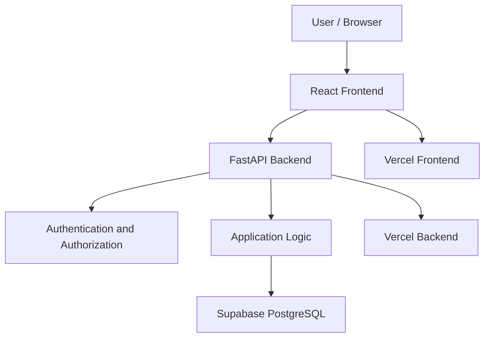
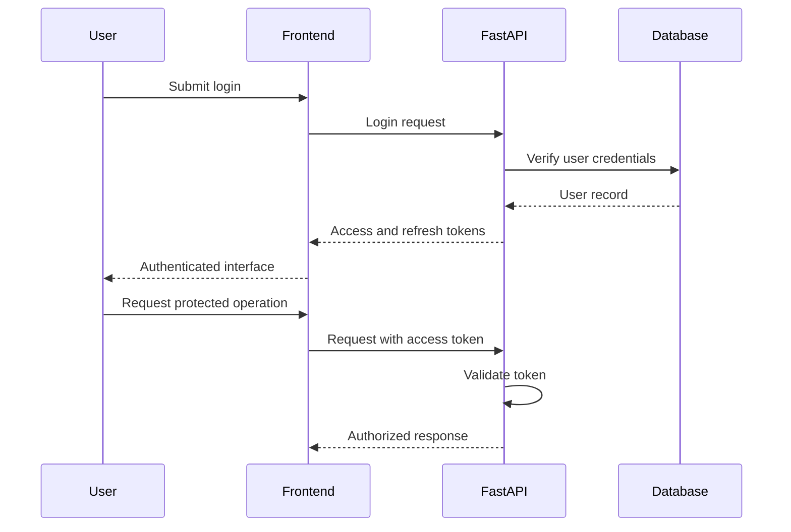

# Technical Design Document (TDD) — Saints Nexus

## 1. Introduction

Saints Nexus is a web-based e-learning platform developed for the CSE309 Web Applications course at Independent University, Bangladesh (IUB). The platform provides course browsing, user authentication, profile management, administrative functionality, session management, audit logging, and a permission-based collaborative workspace.

This document describes the technical architecture, technologies, system components, API structure, database integration, security design, testing, and deployment of Saints Nexus.

## 2. Technology Stack

| Component | Technology |
|---|---|
| Frontend | React 19 |
| Programming Language (Frontend) | TypeScript |
| Frontend Build Tool | Vite |
| Backend | FastAPI |
| Programming Language (Backend) | Python |
| Database | Supabase PostgreSQL |
| Authentication | JWT |
| Password Hashing | Argon2 |
| API Documentation | OpenAPI / Swagger UI |
| Frontend Deployment | Vercel |
| Backend Deployment | Vercel |
| Version Control | Git |
| Repository Hosting | GitHub |
| Automated Backend Testing | Pytest |

## 3. System Architecture

Saints Nexus follows a client-server architecture.

- **Frontend:** React and TypeScript provide the user interface, navigation, forms, course catalogue, dashboards, and client-side interactions.
- **Backend:** FastAPI processes requests, validates input, authenticates users, enforces authorization, and manages application logic.
- **Database:** Supabase PostgreSQL stores application data.
- **Authentication:** JWT-based access authentication and refresh-token rotation provide session-related functionality.
- **Deployment:** Vercel hosts the deployed frontend and backend.

### Architecture Flow



## 4. Project Structure

```text
SaintsNexus/
├── backend/
│   ├── main.py
│   ├── database.py
│   ├── routers/
│   │   ├── auth.py
│   │   ├── admin.py
│   │   └── groups.py
│   └── tests/
│       └── test_api.py
├── frontend/
│   ├── src/
│   │   ├── context/
│   │   │   └── AuthContext.tsx
│   │   ├── pages/
│   │   │   ├── BasicPages.tsx
│   │   │   └── GroupWorkspace.tsx
│   │   ├── services/
│   │   │   ├── api.ts
│   │   │   └── authService.ts
│   │   ├── types/
│   │   │   └── auth.ts
│   │   └── App.tsx
│   └── .env.local
├── docs/
│   ├── PRD.md
│   ├── SRS.md
│   ├── TDD.md
│   ├── FINAL_REPORT.md
│   └── FINAL_SUBMISSION_CHECKLIST.md
└── README.md
```

The structure above represents the principal application files and documentation. Additional supporting files and configuration files are maintained within the repository.

## 5. Database Design

Saints Nexus uses Supabase PostgreSQL as its database platform.

The database supports application functionality including user accounts, course information, authentication sessions, administrative activity, and group workspace resources.

The backend communicates with the database through its database integration layer.

### Principal Data Categories

- User account and profile information
- Course records
- Authentication and refresh-token session records
- Administrative activity and audit records
- Group workspace resources and permission-related records

Database access is handled by the backend application rather than by directly exposing database credentials to the frontend.

## 6. Backend Design

The backend is developed using FastAPI.

### 6.1 Main Application

`backend/main.py` initializes the FastAPI application, configures cross-origin access, registers application routes, and provides health and course-related endpoints.

### 6.2 Database Integration

`backend/database.py` provides the database integration used by the application to communicate with Supabase.

### 6.3 Authentication Router

`backend/routers/auth.py` handles authentication and user-related operations, including:

- Registration
- Login
- Password hashing and verification
- Access-token authentication
- Refresh-token rotation
- Logout and session revocation
- Profile-related operations
- Password changes
- Session management

### 6.4 Administrative Router

`backend/routers/admin.py` handles administrator-specific functionality, including:

- Administrative user listing
- Role management
- Ban and unban operations
- Administrative activity logs
- Administrative access control

### 6.5 Group Router

`backend/routers/groups.py` implements the PROJECT AVENGERS collaborative workspace and its permission-controlled resource operations.

The router enforces group-specific permissions on the backend.

### 6.6 Backend Tests

`backend/tests/test_api.py` contains automated tests for selected backend functionality using Pytest.

## 7. Frontend Design

The frontend is developed using React 19, TypeScript, and Vite.

### 7.1 Application Entry and Navigation

`frontend/src/App.tsx` manages application routing, page rendering, and the primary application structure.

### 7.2 Authentication Context

`frontend/src/context/AuthContext.tsx` manages frontend authentication state and provides authentication-related information to application components.

### 7.3 API Services

`frontend/src/services/api.ts` provides API communication support.

`frontend/src/services/authService.ts` handles authentication-related API interactions.

### 7.4 User Interface Pages

`frontend/src/pages/BasicPages.tsx` contains primary user-facing pages, including the dashboard, profile, and administrative dashboard.

`frontend/src/pages/GroupWorkspace.tsx` provides the collaborative group workspace interface and permission-dependent actions.

### 7.5 Type Definitions

`frontend/src/types/auth.ts` defines TypeScript types used by authentication-related functionality.

## 8. API Design

The backend exposes REST-style HTTP endpoints.

| Endpoint | Method | Purpose |
|---|---|---|
| `/api/health` | GET | Health check |
| `/api/hello` | GET | Sample API endpoint |
| `/api/courses` | GET | Retrieve course catalogue |
| `/api/courses/{course_id}` | GET | Retrieve a specific course |
| `/api/courses` | POST | Create a course |
| `/api/courses/{course_id}` | PUT | Update a course |
| `/api/courses/{course_id}` | DELETE | Delete a course |
| `/api/groups/project-avengers` | GET | Retrieve group information |
| `/api/groups/project-avengers/resources` | GET | Retrieve group resources |
| `/api/groups/project-avengers/resources` | POST | Create a group resource |
| `/api/groups/project-avengers/resources/{resource_id}` | PUT | Update a group resource |
| `/api/groups/project-avengers/resources/{resource_id}/assign` | PATCH | Assign a group resource |
| `/api/admin/users` | GET | Retrieve administrative user listing |
| `/api/admin/users/{user_id}/role` | PATCH | Update a user's role |
| `/api/admin/users/{user_id}/ban` | PATCH | Ban a user |
| `/api/admin/users/{user_id}/unban` | PATCH | Unban a user |
| `/api/admin/audit-logs` | GET | Retrieve administrative activity logs |

Authentication-related endpoints are implemented in the authentication router.

The exact request and response specifications can be inspected through the deployed Swagger documentation.

## 9. Authentication Design

Saints Nexus implements JWT-based authentication.

### Authentication Process

1. A user submits registration or login information.
2. The backend validates the submitted information.
3. Passwords are hashed using Argon2 before storage.
4. During login, the backend verifies the submitted password against the stored password hash.
5. Upon successful authentication, the backend issues authentication tokens.
6. Access tokens are used to authenticate protected API requests.
7. Refresh-token rotation provides a mechanism for renewing authentication.
8. Logout and session-revocation operations invalidate the associated refresh-token session.

Access tokens have a documented short lifetime of 15 minutes.

Refresh-token values are stored in hashed form on the server side.

### Authentication Sequence



## 10. Role-Based Access Control

Saints Nexus implements role-based authorization for administrative operations and permission-based authorization for the PROJECT AVENGERS workspace.

### 10.1 Platform Roles

- Normal users access permitted user functionality.
- Administrators access protected administrative functionality.

Administrative privileges are validated by the backend.

### 10.2 PROJECT AVENGERS Permissions

| Member | Create | Update | Assign | View |
|---|---|---|---|---|
| saints_adminX (Owner) | Yes | Yes | Yes | Yes |
| saints_userZ | Yes | Yes | No | Yes |
| saints_userZ2 | No | No | Yes | Yes |
| saints_userZ3 | No | No | No | Yes |

### 10.3 Permission Enforcement

The backend checks the relevant permissions before processing group resource operations.

Frontend controls are conditionally displayed based on available permissions. However, backend authorization is the primary enforcement mechanism.

Unauthorized operations are rejected by the backend.

## 11. Administrative Dashboard Design

The administrative dashboard provides selected administrative functionality.

Features include:

- User statistics
- User listing
- Client-side search and filtering
- Pagination
- Role management
- Ban and unban functionality
- Administrative activity logs

Administrative operations are protected by backend authorization.

## 12. Security Design

| Security Concern | Implementation |
|---|---|
| Password storage | Argon2 password hashing |
| Authentication | JWT-based authentication |
| Access-token expiration | Short-lived access tokens |
| Refresh-token security | Token rotation and hashed refresh-token storage |
| Session management | Session listing and revocation |
| Logout | Refresh-session revocation |
| Authorization | Backend role and permission checks |
| Administrative protection | Restricted administrative endpoints |
| Group authorization | Backend permission enforcement |
| Banned accounts | Backend account-status enforcement |
| Auditability | Administrative audit logs |
| API communication | HTTP API architecture with deployed HTTPS endpoints |

### Security Limitations

The current implementation does not include a dedicated brute-force prevention or rate-limiting system.

Authentication tokens are handled by the implemented frontend authentication architecture and are not implemented through a dedicated HttpOnly-cookie authentication design.

These limitations are documented for future improvement.

## 13. Deployment Design

Saints Nexus is deployed using Vercel.

### Frontend Deployment

- Platform: Vercel
- Framework: React / Vite
- Build process: Vite production build
- API configuration: Environment-based backend URL

### Backend Deployment

- Platform: Vercel
- Framework: FastAPI
- Database: Supabase PostgreSQL

### Environment Configuration

The frontend uses the environment variable:

`VITE_API_URL`

This variable identifies the backend API base URL.

Sensitive backend configuration and database credentials are managed through backend environment configuration and are not intended to be exposed in the frontend.

## 14. Testing Strategy

The project uses automated backend tests and frontend build verification.

### Backend Testing

Pytest is used to test selected backend functionality.

Test coverage includes:

- API health
- Sample API response
- Course retrieval
- Missing-course handling
- Course creation authorization
- Administrative course creation
- Password hashing
- Incorrect-password rejection
- Authentication requirements for protected endpoints

### Frontend Verification

The frontend production build is verified using Vite.

### Additional Verification

- API endpoint inspection through Swagger UI
- Authentication and authorization testing
- Manual application verification
- Git diff validation

### Verified Results

The documented verification results include:

- Backend automated tests: 9 passed
- Frontend production build: Successful
- Git diff validation: Passed

## 15. Limitations and Future Improvements

Potential future improvements include:

- Brute-force protection and rate limiting
- HttpOnly-cookie-based authentication
- CSV export
- Server-side filtering and pagination
- Dedicated failed-login security analytics
- Comprehensive user-detail security views
- General group creation and member administration
- Bulk administrative actions
- Expanded automated security and permission tests
- Additional course-learning and content-management features

## 16. Conclusion

Saints Nexus implements a full-stack web application architecture using React, TypeScript, FastAPI, and Supabase PostgreSQL. It integrates authentication, course management, administrative functionality, session management, audit logging, and a permission-controlled collaborative workspace.

The application uses backend authorization, JWT-based authentication, password hashing, automated backend tests, and deployment through Vercel.

The technical design establishes the foundation for further development, security improvements, and additional e-learning functionality.